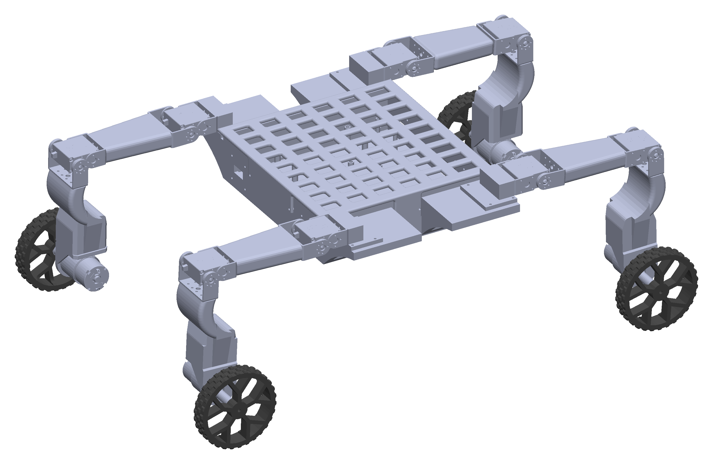
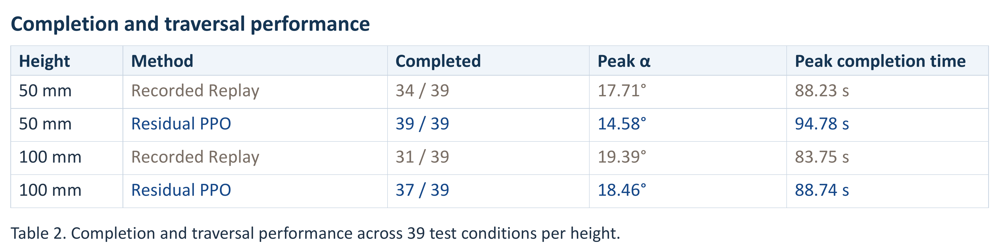
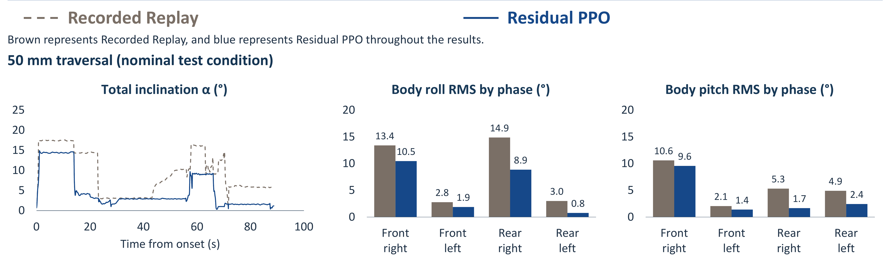
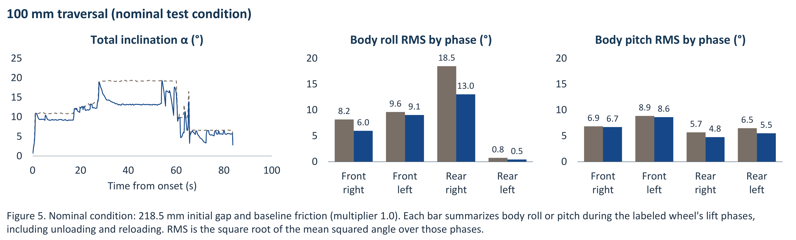

# Residual PPO for Body Leveling of Wheel-Legged Robots During Obstacle Traversal

**Junxian Zhu · Duke University**

## Project overview

This project develops a recording interface and a residual reinforcement-learning controller for wheel-legged obstacle traversal. The robot combines rolling motion with sequential wheel lifting to cross a step. The body-leveling objective is to limit chassis inclination as wheels unload, move over the obstacle, and return to contact.

The platform has four articulated wheel legs, eight leg joints, and four driven wheels. Experiments use Isaac Sim and Isaac Lab to evaluate 50 mm and 100 mm step traversal.

## Recording

The Recording interface stages hip, knee, and wheel targets and applies them together at launch. Start and stop controls define each capture interval. Accepted steps form a sequence that can be inspected, replayed, and saved.

Each step records command events, duration, boundary states, and task metadata. These sequences provide the nominal joint and wheel commands for obstacle traversal. PPO collects training experience through interactions with the simulator.

## Residual PPO

Residual PPO adds learned corrections to the recorded motion reference. Body orientation, joint and wheel state, contact forces, support geometry, and obstacle-relative position inform eight joint-angle corrections and four wheel-speed corrections. The control interface applies phase-dependent bounds and actuator limits. Policy decisions run at 15 Hz, with physics and actuator control at 120 Hz.

The 50 mm controller is trained across four components:

1. **Early motion** establishes forward progress and the movement needed to reach the wheel-transfer phases.
2. **Rear-right transfer** learns contact and support transfer around the rear-right wheel.
3. **Following transfer** coordinates front-leg preparation, continued support transfer, and rear-left lift and placement.
4. **Front-left wheel refinement** rewards forward travel and penalizes reverse wheel commands or counter-rotation without progress.

Preceding components retain their weights while each new component learns its correction. PPO uses a clipped policy objective, a critic, and generalized advantage estimation. Rewards combine traversal progress and completion with stage-specific posture, contact, and motion-quality terms. The [50 mm method report](50mm/README.md) details the network architecture and optimization settings.

## Experimental results

Recorded Replay and Residual PPO are compared across 39 approach-distance and friction conditions at each obstacle height: nine fixed conditions and 30 sampled conditions. Nominal comparisons use an initial gap of 218.5 mm and a friction multiplier of 1.0.

Residual PPO completed 39/39 conditions on the 50 mm step and 37/39 on the 100 mm step, compared with 34/39 and 31/39 for Recorded Replay. The nominal comparisons show lower phase-wise roll and pitch RMS with Residual PPO. Completion, peak body inclination, and peak traversal time are reported below.

### 50 mm body leveling

### 100 mm body leveling

## Demonstrations

The [video collection](https://allenzjx.github.io/wheel-legged-body-leveling/#videos) includes 50 mm and 100 mm nominal comparisons, a longer approach distance, and a 100 mm body-collision case. Paired videos use the same camera, scale, task conditions, and physical playback speed. Complete simulator episodes are rendered from recorded link poses; a view that finishes first holds its final pose while the other completes.

The collision case illustrates a remaining failure mode. Physical-robot evaluation and additional terrain testing form the next experimental steps.

## Code and models

The [50 mm simulation and PPO package](50mm/code/) contains the controller, simulation environment, observation and action interfaces, reward definitions, training loop, robot asset, recording reference, and model weights.

- [Training and evaluation instructions](50mm/code/README.md)
- [Environment installation](50mm/code/DEPENDENCIES.md)
- [Execution checks](50mm/code/VERIFICATION.md)

The full-controller evaluation starts at the beginning of the crossing. Stage-training commands continue the supplied component weights with a newly initialized Adam optimizer. The execution checks include a successful 93.6-second full traversal and one PPO training update with saved-model reloading.
